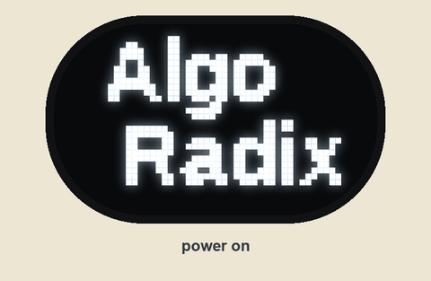
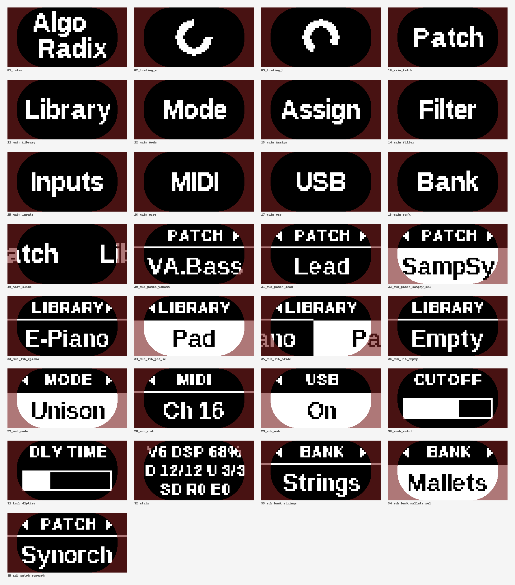

# Algoradix firmware

<p align="center">
  
  <br><sub>The menu, drawn by the firmware's own screen code and slide timing in the simulator (<code>make -C sim ui-video</code>).
  <a href="docs/images/ui-navigation.mp4">MP4</a></sub>
</p>

Open firmware for **Algoradix**, a 12 HP Eurorack synth voice by **Roffa Logics** built around an
[Axoloti Core v1.2](https://github.com/axoloti/axoloti) (STM32F427 at 168 MHz, ADAU1961 codec, 8 MB SDRAM,
micro-SD, USB device and USB host, MIDI). The hardware (interface board, connector board, panels) is in the companion
repository **[algoradix-hardware](https://github.com/Gianducaconte/algoradix-hardware)**.

This is a **from-scratch, bare-metal C firmware**. It uses no Axoloti code and no RTOS. The only third-party code is
ARM CMSIS, ST's device header, FatFs and TinyUSB.

The firmware is a **patch host**. It runs the hardware: panel, menu, MIDI over DIN and USB host with merge and thru,
two effect slots, master volume, SD card and USB. The sound engine is a **patch file on the SD card** (`.APX`). It is
loaded into RAM and **swapped without a reboot**. Each patch declares its own knob names, its two effects and its menu
pages. So the same module can be a bass synth, a poly synth, a sample player, a vocoder or an effect. From the
module's USB page, the card shows up as a **USB drive** on your computer. Patches and samples are copied over the same
cable that flashes the module.

> **What's included:** the host firmware, the patch SDK with three demo patches and two templates, a desktop
> simulator that renders patches to WAV through the same DSP code, and the tools to build card content.
> The large patch library we run on our own units isn't part of this release.

## Contents

- [Quick start](#quick-start-flash-the-release)
- [What the panel does](#what-the-panel-does)
- [MIDI CC map](#midi-cc-map)
- [The SD card](#the-sd-card)
- [Writing your own patch](#writing-your-own-patch)
- [Building from source](#building-from-source)
- [Simulator](#simulator)
- [Repository layout](#repository-layout)
- [Licence](#licence)

## Quick start: flash the release

You need [`dfu-util`](https://dfu-util.sourceforge.net/) (`brew install dfu-util`, `apt install dfu-util`, or the
Windows build) and a mini-USB cable. The STM32 has a ROM bootloader that no firmware can erase, so **you can always
recover**. The full procedure, including how to back up the original Axoloti flash first, is in
[docs/flashing.md](docs/flashing.md).

1. Unplug USB. **Hold S1** on the Axoloti Core, plug in the mini-USB, then release S1.
2. `dfu-util -l` should list `0483:df11`.
3. Flash:
   ```bash
   dfu-util -d 0483:df11 -a 0 -s 0x08000000:leave -D releases/algoradix-v1.0.0.bin
   ```
   The module restarts into the new firmware right away.
4. Card: unzip `algoradix-card-v1.0.0.zip` from the release onto a FAT32 micro-SD, so that the card holds
   `/ALGORADIX/PATCHES/` and `/ALGORADIX/SAMPSY/`. You can also build that folder yourself, see
   [the SD card](#the-sd-card).

Without a card, the module boots into the built-in engine and is fully playable.

## What the panel does

The printed labels are positions, not fixed meanings. **When you move a knob, the display shows its name for the
current patch** with a bar for 1.5 s. For example, f1 and f2 show the patch's own macro names, such as Shape and Sub.

### Knobs and jacks

| Control | Function |
|---|---|
| LEVELS | master volume |
| TUNE (+ jack) | fine tune ±1 semitone for MIDI notes (centre = in tune; held notes bend smoothly). For the CV voice it sets the pitch, and the jack is 1 V/oct |
| OCT | octave −2…+2, all voices |
| f1 / f2 (+ CV) | the two **macros** of the current patch |
| FILT (+ CV) | filter cutoff |
| A, D (+ D CV) | amp envelope attack; decay **and** release (always the same time) |
| ASSIGN jack | set on the Assign page: **GATE** (plays a note at the TUNE pitch), **ATTACK** or **OCTAVE** (1 V/oct, quantised) |
| AUDIO IN | set on the Inputs page: off, mixed into the output, or **ring-modulated** with the synth |
| MIDI IN + USB HOST | notes, velocity, pitch bend, sustain pedal, mod wheel (vibrato), clock, CCs. Both inputs are **merged**. Everything goes out of **MIDI OUT (thru, always on)** as whole messages |

### FUNC layer: hold the GATE button and turn a knob

FUNC changes are relative, with pick-up. While FUNC is held, the knob's normal value is frozen until you move the knob
back to it. A big overlay names what you're changing. TUNE is never layered.

| FUNC + | Function |
|---|---|
| f1 | **FX1 amount**. The display shows the patch's effect: DELAY, REVERB, CHORUS, DRIVE or CRUSH |
| OCT | **FX1 parameter**: DLY TIME, REV SIZE, CH DEPTH, TONE or BITS. With MIDI clock, delay time snaps to 1/16, 1/8, 1/8D, 1/4 or 1/2 |
| f2 | **FX2 amount** |
| LEVELS | **FX2 parameter** |
| FILT | resonance |
| A / D | filter envelope attack / decay (one-shot per note; 0 / 0 = off) |

### Menu: one word per screen, sliding horizontally

- **Main menu:** one big word. Turn the encoder for the next or previous page, click to open it.
- **Option list:** a small caption with the option shown big below. Turn to move between options, click to select
  (the selected option is shown inverted). Hold for 0.6 s to go back.

<p align="center">
  
  <br><sub>Every screen, rendered pixel-exact by the simulator (<code>make -C sim ui</code>). The tinted edges are hidden by the faceplate.</sub>
</p>

| Page | Options |
|---|---|
| Bank | one bank per folder on the card (shown only when there's more than one) |
| Patch | every patch in the bank, then Built-in (the fallback engine in the firmware) |
| Library | the content that belongs to the running patch: its sounds, kits or variants |
| Mode | Poly, Unison, Mono (with glide) |
| Assign | Gate, Attack, Octave |
| Filter | HP, BP, LP |
| Inputs | Off, Mix, Ring |
| MIDI | Omni, Ch 1…16 |
| USB | Off, **On (the SD card becomes a USB drive on the computer** while the patch keeps playing) |

Mode, Assign, Filter and Inputs only appear when the patch asks for them. A patch can also add one page of its own.

**Shortcuts:**
- FUNC + click jumps to Library.
- FUNC + turn steps through the library from anywhere.
- FUNC + hold the encoder for 1.5 s opens a statistics screen (voices, DSP %, MIDI counters, SD retries).

**Every patch keeps its own settings.** The FUNC-layer values, Mode, Assign, Filter, Inputs and the Library item are
stored per patch in flash and come back when you select that patch again. Saving is automatic, 3 s after a change
once no note is sounding.

## MIDI CC map

The map is fixed and works with every patch.

| CC | Function | | CC | Function |
|---|---|---|---|---|
| 1 | mod wheel: vibrato depth (or the patch's own LFO target) | | 71 | resonance |
| 5 | glide time | | 72 / 73 | decay = release / attack |
| 7 | master volume | | 74 | cutoff |
| 12 / 13 / 14 | FX1 parameter / parameter 2 / amount | | 75 | sustain level |
| 15 / 16 / 17 | key tracking / analog drift / drive | | 76 / 77 | LFO rate / LFO target (off, pitch, cutoff, PWM) |
| 20 / 21 | f1 / f2 macros | | 91 / 92 / 95 | FX2 amount / parameter / parameter 2 |
| 22 / 23 | filter envelope attack / decay | | 93 / 94 | chorus mix / unison detune |
| 64 | sustain pedal | | 120, 123 | all notes off |
| 102–115 | free for the patch's own parameters | | | |
| **Program Change**, **116** | **recall a Patch** by position in the bank (0 = first) | | **117** | **recall a Library item** of the running patch |
| **0** (Bank Select) | **choose the bank** for the next Program Changes (0 = Core) | | | |

A CC on a knob's parameter (7, 20, 21, 72, 73, 74) takes it over until you move the knob again. The MIDI channel
filter applies to CCs too.

## The SD card

```
/ALGORADIX/PATCHES/*.APX            bank "Core": patch files directly in PATCHES, in file-name order
/ALGORADIX/PATCHES/<n-Name>/*.APX   one more bank per folder ("3-Pad" is shown as "Pad")
/ALGORADIX/SAMPSY/<Sound>/*.wav     the library of the SampSy patch: one folder = one sound
```

Build the card content and copy it over:

```bash
make -C firmware/patchsdk                              # -> firmware/patchsdk/build/card/ALGORADIX
# on the module: USB page -> On. The card mounts on the computer.
make -C firmware/patchsdk install CARD=/Volumes/<card>   # then eject on the computer
```

| Patch | f1 / f2 | FX1 / FX2 | What |
|---|---|---|---|
| **VA.Bass** | Shape / Sub | DIST / CRUSH | saw + PWM pulse + square sub an octave down, driven ladder filter. Mode = Mono for a glide bass |
| **Lead** | Detune / Octave | DELAY / REVERB | polyphonic lead: two detuned saws + an upper-octave pulse |
| **SampSy** | Bright / Wide | DELAY / REVERB | polyphonic sample player for plain **.wav** files, with 21 synthetic demo sounds |

**SampSy sounds:** put 16- or 24-bit WAVs (mono or stereo, any sample rate, about 7 MB per sound) in a folder under
`/ALGORADIX/SAMPSY/`. Each file's root note comes from its `smpl` chunk, or from a note name in the file name
(`PIANO_C3.wav`, where C4 = 60). Loops stored in the file are played.

**Safety:** before the running patch is touched, the host checks the patch file (ABI, sizes, addresses, CRC-32).
If a patch crashes the processor, the module restarts on the built-in engine, shows "Patch err" and won't auto-load
that patch again. A patch that overloads the CPU is silenced and the screen shows "Overload".

## Writing your own patch

A synth engine is one C file written against the DSP library (oscillators, filters, envelopes, a polyphonic
allocator and a shared "voice frame"), plus one line that declares the patch:

```c
APX_INSTRUMENT(apx_header, APX_HEADER_ATTR, my_engine, "MySynth", "Shape", "Sub",
               APX_FX_DELAY, APX_FX_REVERB, APX_PAGES_INSTRUMENT)
```

Start with [`firmware/patchsdk/demo/bass.c`](firmware/patchsdk/demo/bass.c) (about 40 lines) or the templates in
[`firmware/patchsdk/templates/`](firmware/patchsdk/templates/). **The full guide is
[`PATCH-GUIDE.md`](firmware/patchsdk/PATCH-GUIDE.md).** It covers the CPU and memory budgets measured on the module,
the rules that keep a patch from crashing it, and a check-list. It's written for people and for AI coding agents,
and it works well when you hand it to one as context.

Add your patch to `firmware/patchsdk/Makefile` (`PATCHES += NAME`, `SRC_NAME := my/file.c`), run `make`, listen to
it in the simulator, then copy it to the card.

## Building from source

You need `arm-none-eabi-gcc` (tested with 10.3 and 16.2; no C library needed), GNU make, Python 3 with NumPy (card
build: demo sounds) and Pillow (font and UI preview tools), `dfu-util`, and a host C compiler for the simulator.

```bash
cd firmware
make            # the patch host (STAGE=5) -> build/stage5/algoradix.bin
make flash      # board in DFU mode (hold S1 while plugging in USB)
make backup     # one-time: dump the full 1 MB flash to ../backup/ before your first flash
```

`make STAGE=0`…`4` build the bring-up tests (heartbeat, panel test, audio test, the older all-in-one synth, SD test),
described in [docs/flashing.md](docs/flashing.md).

**Reproducible:** building this tree with GCC 10.3.1 (`arm-none-eabi-gcc 10.3-2021.07`) gives a file that is
byte-for-byte the same as `releases/algoradix-v1.0.0.bin` (SHA-256 in [`releases/SHA256SUMS`](releases/SHA256SUMS)).

## Simulator

The same DSP sources, compiled for your computer, render a patch to a WAV. Use it to hear a patch before you flash
anything:

```bash
cd sim
make apx PATCH=demo/bass.c && ./build/apxsim out.wav      # a card patch through the real ABI and effect slots
make ui                                                   # the firmware's screens -> build/ui/sheet.png
make ui-video                                             # a scripted menu session -> build/ui/ui-navigation.mp4 / .gif (ffmpeg)
make && ./build/sim out.wav 0                             # the built-in engines (index 0..19)
```

You can script the render with environment variables: `SEQ="t:note:vel:dur,…"`, `SECS`, `F1` `F2` `FILT` `DEC`,
`FX`, `MODE` (0 poly, 1 unison, 2 mono), `BPM` (MIDI clock), `INWAV=<wav>` (audio input from a file), `COST=1`
(time spent per block).

## Repository layout

| Path | What |
|---|---|
| `firmware/` | the host firmware: drivers (`hal/`), panel and display (`panel/`), DSP library (`dsp/`), built-in engines (`patches/`), menu (`ui/`), the host (`app/`), sampler, linker scripts |
| `firmware/board/board_algoradix.h` | every pin and every measured hardware constant, in one file |
| `firmware/patchsdk/` | the patch SDK: ABI (`apx.h`), instrument adapter, linker script, demo patches, templates, [PATCH-GUIDE.md](firmware/patchsdk/PATCH-GUIDE.md) |
| `sim/` | desktop build of the DSP and UI code |
| `tools/` | `apx_pack.py` (finishes a patch file), `make_demo_wavs.py` (SampSy demo sounds), `make_ui_font.py` + `fonts/`, `ui_preview.py`, `ui_video.py`, `axb_convert.py` (sample bank converter for the STAGE 3 synth) |
| `docs/` | [flashing and recovery](docs/flashing.md), [measured hardware facts](docs/hardware-facts.md) |
| `releases/` | release binaries and checksums |

## Licence

Copyright © 2026 Roffa Logics.

The firmware is free software under the **GNU General Public License v3.0**. See [LICENSE](LICENSE). The vendored
libraries keep their own permissive licences, listed in [THIRD_PARTY.md](THIRD_PARTY.md).

A patch built with the SDK statically links the DSP library and the instrument adapter (`dsp/`, `apx_inst.c`). So
if you distribute a patch `.APX`, that binary falls under the GPL too: share its source under GPL-3.0.

Algoradix runs on Axoloti Core hardware but is independent of the Axoloti project, which hasn't endorsed it.
